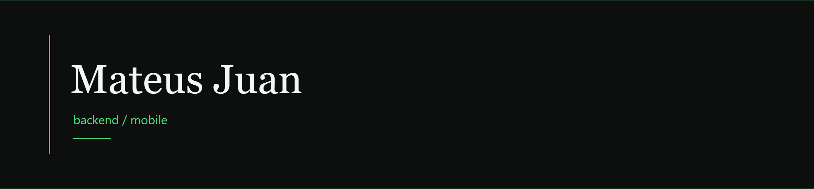

## sobre

Sou formado em Técnico em Desenvolvimento de Sistemas pelo IFPE de Jaboatão dos Guararapes, junto ao ensino médio, e hoje curso Engenharia da Computação no CIn-UFPE.

Gosto de colocar a mão na massa e construir sistemas de ponta a ponta: Node.js no servidor e React Native no celular. No desenvolvimento mobile, uso Expo, Expo Go e EAS. Atualmente, o projeto que mais ocupa meu tempo é o N4VIX, um app de otimização de rotas pensado para facilitar o dia a dia de entregadores da Shopee.

No momento, também estou aprendendo Kotlin e buscando sempre conhecer novas tecnologias e formas de transformar ideias em software.

## tecnologias

### estudando

 Kotlin · em andamento

### já sei usar

#### linguagens

      
    

  

HTML · CSS · JavaScript · TypeScript · Python · Java · MySQL · PostgreSQL · C++ · Arduino · EJS

#### frameworks

      
      
  

  

Node.js · Express · NestJS · Prisma · React · Next.js · Flask · Spring Boot · Tailwind · Bootstrap · Electron · Pygame · Expo · Fastify · React Native

#### plataformas

    

  

Supabase · Docker · Railway · Expo Go · EAS

## projetos

O projeto em que eu mais foco agora.

<table>
<tr>
<td valign="top">
<b>N4vix</b> 
  
Aplicativo de roteirização de entregas para entregadores da Shopee, com mapa interativo via Mapbox. App em React Native, backend em Node.js com Express e PostgreSQL.
  
<a href="https://n4vix.vercel.app/">site</a> · <a href="https://play.google.com/store/apps/details?id=com.deliveryrace.app">Play Store</a>
</td>
</tr>
</table>

## no github

  

  

  

  

    
  
Mateus Juan · Brasil

